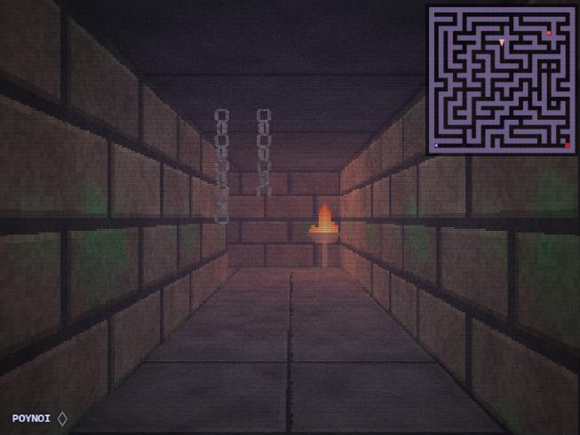
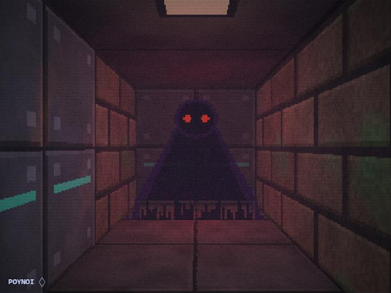
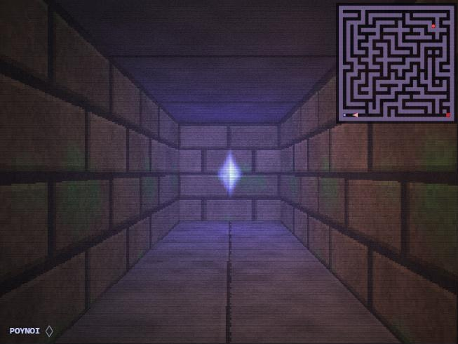
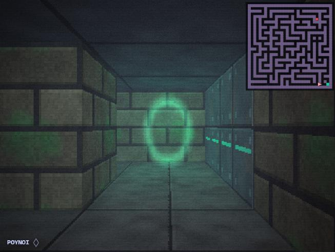
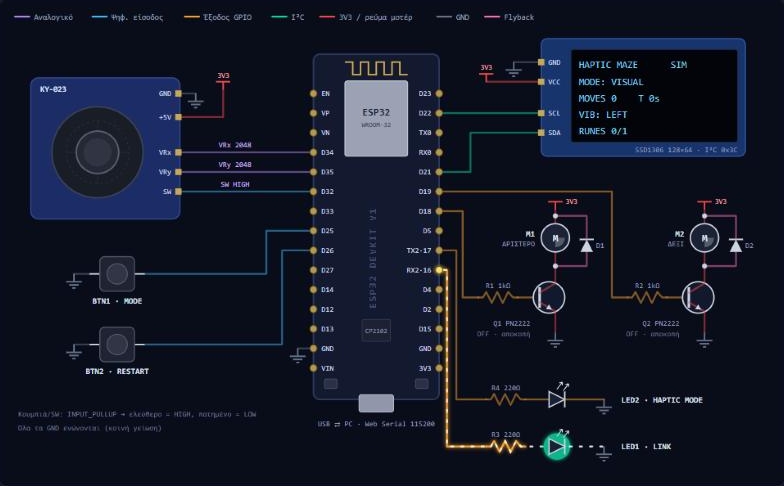

<div align="center">

# Fogbound

**A first-person haptic maze. You find the way out by touch.**

A foggy, late-90s-style labyrinth rendered in vanilla JavaScript, played with a DIY **ESP32 controller** that has a joystick and **two vibration motors**. The motors tell you where to turn, warn you when something is hunting you, and confirm when you pick something up.

*Built for a university course on Haptic Interfaces.*

[🇬🇷 Ελληνικός οδηγός](docs/README.el.md) · [Firmware](esp32/firmware/firmware.ino) · [Haptic vocabulary](#haptic-vocabulary)

 
 

</div>

---

## The idea

Can you navigate a maze when you can barely see it?

In **Haptic mode** the fog is so thick that you see a few tiles ahead at most, and there is no map. A breadth-first search finds the shortest route, and the controller turns the next step into a vibration **relative to where you are facing**:

| You feel | It means |
|---|---|
| left motor | turn left |
| right motor | turn right |
| both, one short pulse | go forward |
| both, two short pulses | the way is behind you |

On top of navigation there is a second, parallel haptic channel: **threat**. When the Shade gets within 6 steps, the controller starts a fast "purr" that repeats more and more often as it closes in. In Haptic mode this is the only warning you get.

**Visual mode** has lighter fog and a minimap, which gives you the baseline condition for a small user study.

## Features

- **Raycaster from scratch.** It renders at 320×240 and upscales the image with hard pixels. It has procedural textures (mossy bricks, riveted panels), coloured distance fog, dynamic point lights, billboard sprites, head-bob, scanlines and film grain. There are no images, libraries or build step.
- **A seeded maze.** The maze is a recursive backtracker with a few loops added, so wrong turns are real choices. The same seed always gives the same maze, which keeps experiment conditions fair.
- **Challenge.**
  - Collect the **runes** to unseal the portal.
  - Avoid **the Shade**. It wanders the maze and hunts you once you get close.
  - Braziers, toxic barrels, crates and chains add atmosphere, and the braziers light the space around them.
- **A virtual circuit.** You can play with no hardware at all. An interactive schematic of the whole controller (ESP32 DevKit, KY-023 joystick, NPN motor drivers with flyback diodes, LEDs, SSD1306 OLED) reacts live. Wires "flow" when a signal is active, the motors shake, and hovering a part shows the electronics behind it (e.g. *I<sub>B</sub> ≈ (3.3 − 0.7) / 1 kΩ ≈ 2.6 mA → Q1 saturated*). A small scope traces the GPIOs.
- **Stereo buzz.** With headphones, the left motor buzzes in your left ear and the right motor in your right, so you can test Haptic mode without the controller.
- **Real hardware over Web Serial.** Plug in the ESP32 and the virtual board mirrors the physical one.
- **Experiment logger.** Every finished run records time, steps, wrong steps, wall hits, how many times the Shade caught you and efficiency (optimal / actual steps). It shows averages per mode and exports to CSV.

## Quick start

You need **Chrome or Edge on desktop**, because Web Serial is Chromium-only.

```bash
git clone https://github.com/Javakios/fogbound.git
cd fogbound
npx serve .
```

Then open the address it prints (e.g. `http://localhost:3000`). Any static server works, e.g. `python -m http.server`.

| Input | Keyboard | Controller |
|---|---|---|
| Step forward / back | `W` `S` / `↑` `↓` | joystick up / down |
| Turn 90° | `A` `D` / `←` `→` | joystick left / right |
| Repeat the hint | `Space` | press the joystick (SW) |
| Visual ↔ Haptic | `M` | BTN1 |
| Restart | `R` | BTN2 |
| Fullscreen | `F` | – |

Difficulty: **Easy** (no runes, no Shade) · **Normal** (1 rune, slow Shade) · **Hard** (3 runes, fast Shade).

## The controller

<p align="center"></p>

| Part | Qty | Connects to |
|---|---|---|
| ESP32 DevKit V1 (30-pin) | 1 | USB to the PC |
| KY-023 analog joystick | 1 | VRx → GPIO34, VRy → GPIO35, SW → GPIO32, **+5V pin → 3V3** |
| Coin vibration motor, 3 V | 2 | driven by NPN low-side switches |
| PN2222 / 2N2222 NPN transistor | 2 | base via 1 kΩ from GPIO18 (left) / GPIO19 (right) |
| 1N4001 diode | 2 | across each motor, cathode to 3V3 (flyback) |
| Push buttons | 2 | GPIO25 / GPIO26 to GND (internal pull-ups) |
| LEDs + 220 Ω | 2 | GPIO16 (link), GPIO17 (haptic mode) |
| SSD1306 0.96″ OLED, I²C | 1 | SDA → GPIO21, SCL → GPIO22 |

> ⚠️ Power the joystick from **3V3, not 5V**: the ESP32's ADC pins are not 5 V tolerant. Check your transistor's E-B-C pinout in its datasheet, because it varies by manufacturer.

**Firmware:** in the Arduino IDE, install *esp32 by Espressif* plus the *Adafruit SSD1306* and *Adafruit GFX* libraries. Select *ESP32 Dev Module* and flash [`esp32/firmware/firmware.ino`](esp32/firmware/firmware.ino). Close the Serial Monitor, then click **Connect ESP32** in the page. With no PC attached, the board runs a self-test: push the joystick left or right and the matching motor buzzes.

### Serial protocol (115200 baud, one command per line)

```text
PC    → ESP32   H:L                  play haptic pattern
PC    → ESP32   S:H,12,34,L,0        mode, steps, seconds, last pattern, won
ESP32 → PC      J:2048,1950,0,0,0    joystick x, y, sw, btn1, btn2   (~30 Hz)
```

## Haptic vocabulary

Every pattern is a list of `[left, right, ms]` steps. The patterns are identical in [`js/haptics.js`](js/haptics.js) and the firmware.

| Code | Meaning | Pattern |
|---|---|---|
| `L` | turn left | left · 170 ms |
| `R` | turn right | right · 170 ms |
| `U` | go forward | both · 90 ms |
| `D` | it's behind you | both · 80 ms ×2 |
| `W` | wall | both · 450 ms |
| `K` | rune collected | left → right → both |
| `E` | **danger: the Shade is near** | 4 × 30 ms bursts, repeating faster as it approaches |
| `X` | caught | 250 · 250 · 650 ms |
| `G` | exit reached | left/right alternating + long |

## Project layout

```text
index.html, style.css
js/
  maze.js         seeded maze generator
  navigation.js   BFS distance field + next step
  game.js         rules, runes, the Shade, difficulty, camera
  raycaster.js    renderer: textures, fog, lights, sprites, HUD, minimap
  haptics.js      pattern vocabulary, player, stereo buzz
  circuit.js      interactive SVG schematic + live pin table
  scope.js        GPIO oscilloscope
  serial.js       Web Serial link to the ESP32
  main.js         wiring: inputs → game → haptics → hardware
esp32/firmware/firmware.ino
docs/             Greek guide + screenshots
```

## Running a user study

1. Pick one seed and one difficulty for every participant.
2. Train them on the vocabulary with the ▶ buttons in *Haptic vocabulary*.
3. Have each participant solve the maze in **Visual** and in **Haptic** mode, and alternate which mode comes first between participants.
4. Export the CSV. It compares time, wrong steps, wall hits, times caught and efficiency for the two conditions.

With 3–5 participants the results are indicative, not statistically conclusive. They are enough to discuss whether the two-motor vocabulary was easy to learn and whether the danger channel interfered with navigation.

## License

[MIT](LICENSE)
