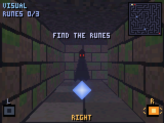
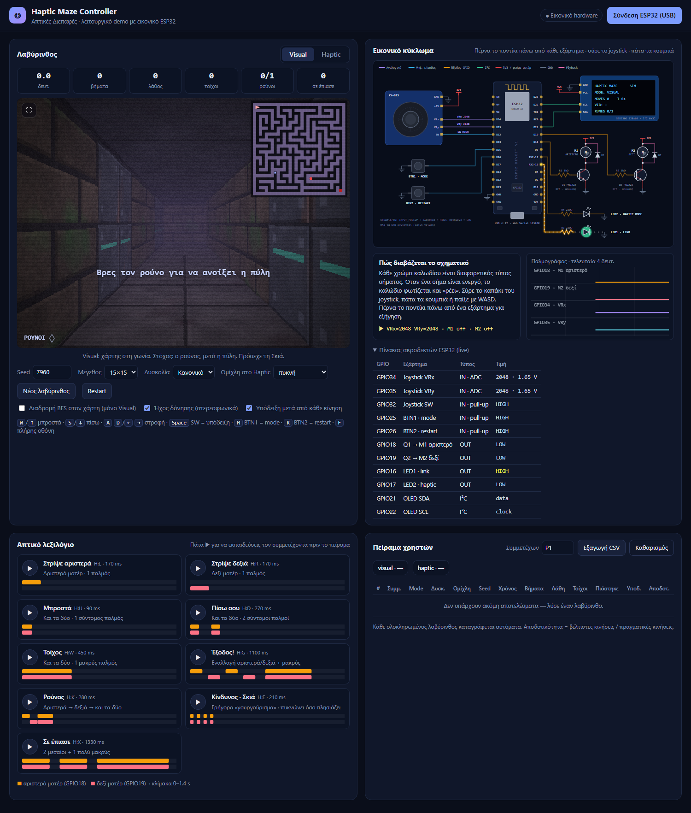

# Fogbound standalone (ESP32 + TFT)

The game runs entirely on the ESP32. No PC, no browser. You hold a breadboard with a screen, a joystick and two vibration motors.



## Parts to buy

| Part | Qty | Notes |
|---|---|---|
| ESP32 DevKit V1 (30-pin, ESP-WROOM-32) | 1 | Any ESP32 dev board works, but check the pin labels match |
| 2.8" TFT SPI display, **ILI9341**, 240x320 | 1 | The version with touch is fine, ignore the touch pins. Must be ILI9341, not ST7789 |
| KY-023 analog joystick | 1 | |
| Coin vibration motor, 3 V (about 10 mm) | 2 | |
| NPN transistor PN2222A / 2N2222 | 2 | Check the E-B-C pinout of your batch |
| Diode 1N4001 (or 1N4148) | 2 | flyback, across each motor |
| Resistor 1 kΩ | 2 | transistor base |
| LED + resistor 220 Ω | 1 | "haptic mode" indicator (LED2 of the schematic) |
| Push button | 2 | |
| Breadboard (830 points) + jumper wires | 1 set | |
| Micro-USB or USB-C cable (matches your ESP32) | 1 | power + flashing |

## Wiring

| ESP32 pin | Goes to |
|---|---|
| GPIO23 | TFT MOSI (SDI) |
| GPIO18 | TFT SCK |
| GPIO19 | TFT MISO (SDO), optional |
| GPIO5 | TFT CS |
| GPIO21 | TFT DC |
| GPIO22 | TFT RST |
| 3V3 | TFT VCC and TFT LED (backlight) |
| GPIO34 | Joystick VRx |
| GPIO35 | Joystick VRy |
| GPIO32 | Joystick SW |
| 3V3 | Joystick +5V pin (**3V3, not 5V**: the ADC pins are not 5 V tolerant) |
| GPIO27 | BTN1 (other leg to GND), mode |
| GPIO14 | BTN2 (other leg to GND), restart / hold for difficulty |
| GPIO25 | 1 kΩ -> base of NPN #1 (left motor) |
| GPIO26 | 1 kΩ -> base of NPN #2 (right motor) |
| GPIO4 | 220 Ω -> LED -> GND, lit in Haptic mode |
| GND | everything else |

Each motor: one leg to 3V3, the other to the transistor collector, emitter to GND, 1N4001 across the motor (stripe/cathode to 3V3).

## Play it on the PC at full speed

The same game core and renderer as the firmware, in a Windows window. The keyboard stands in for the controller and the two motor icons show the vibration.

```bash
g++ -O2 -std=c++17 -mwindows -o play_pc.exe tools/play_pc.cpp src/game.cpp src/render.cpp src/haptics.cpp -lgdi32 -luser32 -lwinmm
./play_pc.exe
```

W/S = forward/back, A/D = turn, Space = repeat hint, M = Visual/Haptic, R = restart, 1/2/3 = difficulty, Esc = quit.

**ESP32 model (on by default, T toggles it).** The game code is identical, but the PC is far faster than an ESP32, so the window paces its frame rate with an estimated cost per frame: render time (default 4 ms) plus the time to send the changed rows to the TFT over SPI (40 MHz, x1.25 overhead), using the same changed-rows logic as the firmware. The window title shows the modelled fps. It does **not** emulate the CPU, RAM or SPI hardware, and the numbers are estimates: `--render-ms=N` and `--spi-mhz=N` change them (use 80 for `--spi-mhz` to see what an 80 MHz bus would give). Once you have the real board, replace them with the values from the `[perf]` line.

## Simulate before you buy (Wokwi)

Wokwi runs the ESP32 tens of times slower than the real chip (the `[bench]` line at boot shows it: 1 million integer adds take ~650 ms, a real ESP32 needs roughly 10 ms), so the frame rate there says little about the real board. `wokwi.toml` points to the `sim` build (80x60, tripled) so it stays usable; the real board uses the `esp32` build (160x120, doubled).


Wokwi simulates the ESP32 and has an ILI9341 display, an analog joystick and buttons. Tinkercad cannot do this: it has no ESP32 and no 320x240 colour display. Wokwi has no vibration motor and no transistors, so the diagram uses two orange LEDs on GPIO25/26 as stand-ins (labelled M1 / M2). They light exactly when the motors would run. The real build has the NPN + diode + motor drivers from the schematic.

The game screen also shows the vibration: two motor icons (L / R) in the bottom corners shake and glow when driven, and the pattern name (LEFT, WALL, DANGER ...) appears between them. This works in the simulator and on the real board.

1. Build the firmware once: `python -m platformio run` in this folder.
2. Install **VS Code** and its **Wokwi Simulator** extension (free licence), open this folder, press F1 -> *Wokwi: Start Simulator*.
   It reads `wokwi.toml` and `diagram.json`.
3. Click and drag the joystick with the mouse. The Serial Monitor prints `[haptic] L`, `[perf] ... fps` etc.

The `[perf]` line tells you how fast the real code runs. Wokwi's speed is not identical to a real ESP32, so treat it as a rough guide.

`diagram.json` was written by hand and has not been opened in Wokwi yet. If a part does not connect, use the wiring table above.

## Flash the real board

```bash
python -m platformio run --target upload
python -m platformio device monitor
```

Controls: joystick up/down = forward/back, left/right = turn, press = repeat hint, BTN1 = Visual/Haptic, BTN2 = restart (hold 1 s = next difficulty).
If forward and back feel swapped, set `JOY_INVERT_Y` to 1 in `src/config.h`.

## Test on the PC without any hardware

```bash
g++ -O2 -std=c++17 -o host_test tools/host_test.cpp src/game.cpp src/render.cpp
./host_test docs
```

It solves the maze by following only the haptic hints (checks the guidance is correct) and writes frames as PPM images.



## What is different from the web version

- Same maze generator and seed, BFS hints, runes, the Shade, haptic vocabulary and difficulties.
- Different pins: the TFT needs the SPI pins, so the motors moved from GPIO18/19 to GPIO25/26, and the OLED, link LED and haptic LED moved (see wiring table).
- Not ported yet: the haptic-vocabulary training panel, the experiment logger and CSV export, stereo buzz, braziers/props, dynamic lights, film grain. On a win it prints a `RESULT ...` line to the serial monitor instead.
- The scene is rendered at 160x120 and doubled, so the picture is chunkier than the browser version.
